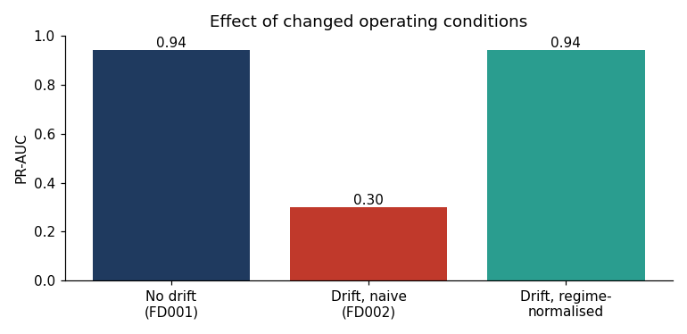

# Explainable and Drift-Aware Predictive Maintenance (NASA C-MAPSS)

Data Science Tutorial, Group 2.
Members: Shrestha Akshovya, Nguyen Thien Phu, Obeid Christina, Abdullah Al Mahmud, Osama Bin Hasan, Hoque Enamul.

## What this project does

Machines are often repaired after they break, or serviced on a fixed schedule even when they are healthy. This project builds an **early-warning system** that reads sensor data and answers one question: *will this engine fail within the next 30 cycles?*

It also:

- **explains** each warning with SHAP, so engineers can see which sensors caused it;
- **checks for drift**, meaning it tests what happens when the operating conditions change after the model is trained, and shows a simple fix.

We use the NASA C-MAPSS dataset (simulated turbofan engines run until failure) as an example of any machine that has sensors. The data is simulated, so the results show that the **method works**. They are not a promise of the same accuracy on real power grid equipment.

## Main results

Overall score is PR-AUC (higher is better, a random guess scores about 0.15).

| Method | 15 held-out engines | 5-fold cross-validation |
|---|---|---|
| Age rule | 0.71 | 0.53 |
| Single-sensor rule | 0.88 | 0.91 |
| Logistic Regression | 0.95 | 0.96 |
| Random Forest | 0.94 | 0.95 |
| XGBoost | 0.94 | 0.96 |

- XGBoost caught 97% of the failing cycles, with a median warning of 35 cycles before failure. All 15 test engines were warned.
- Under our assumed costs (missed alert = 10, false alarm = 1), XGBoost cost 397, against 1,430 for the age rule and 4,650 for doing nothing.
- The most important inputs are the 10-cycle averages of sensors 15, 3, 21 and 11, and the age of the engine.
- **Drift:** the FD001 model used on FD002 (six operating conditions) fell to a PR-AUC of 0.30 and a recall of 0.04. Scaling each operating condition separately brought the PR-AUC back to 0.94 without retraining.



## Repository structure

```
.
├── notebooks/
│   └── CMAPSS_Predictive_Maintenance.ipynb   full experiment with outputs
├── src/
│   └── cmapss_experiment.py                  the same experiment as a plain script
├── data/                                     NASA C-MAPSS files (FD001 and FD002)
├── figures/                                  the 5 charts produced by the experiment
├── results/
│   └── results.json                          key numbers from the final run
├── docs/
│   ├── Predictive_Maintenance_Report.docx    project report
│   └── Predictive_Maintenance_presentation.pptx   project presentation
├── requirements.txt
└── README.md
```

## How to run

1. Install the packages (Python 3.10 or newer):

   ```bash
   pip install -r requirements.txt
   ```

2. Run the notebook:

   ```bash
   jupyter notebook notebooks/CMAPSS_Predictive_Maintenance.ipynb
   ```

   or run the script from the repository root (charts are saved to `figures/`):

   ```bash
   python src/cmapss_experiment.py
   ```

The code looks for the data in `data/`. If the files are missing, it downloads them from a public GitHub copy of the NASA data. A full run takes a few minutes. Random seeds are fixed, so the results are reproducible.

## Data

- **Source:** NASA Prognostics Data Repository, Turbofan Engine Degradation Simulation (C-MAPSS).
- **FD001:** 100 training engines, 100 test engines, 1 operating condition (our main data).
- **FD002:** 260 training engines, 259 test engines, 6 operating conditions (used to test drift).
- Each row is one engine at one cycle: engine number, cycle number, 3 operating settings and 21 sensor readings. The `RUL_*.txt` files give NASA's true remaining life for the test engines.

## Method in short

1. **Target:** a cycle is an alert if the engine fails within 30 cycles (15% of cycles).
2. **Inputs (43 per cycle):** for the 14 sensors that change, the current value, the 10-cycle average and the 10-cycle change, plus the engine age. Only past data is used.
3. **Testing:** split by engine (70 train, 15 tune, 15 test), 5-fold cross-validation by engine, and NASA's official test engines.
4. **Methods compared:** an age rule, a single-sensor rule, Logistic Regression, Random Forest and XGBoost.
5. **Explanations:** SHAP on the XGBoost model.
6. **Drift:** train on FD001, test on FD002, measure the shift with the Kolmogorov-Smirnov statistic, and fix it by scaling each operating condition separately.

## Limitations

- The data is simulated jet engine data, not real power grid equipment.
- Only 100 engines in the main dataset, and 15 held out for the main test.
- The 30-cycle window and the cost values (10 and 1) are our own assumptions.
- False alarms and misses are counted per cycle, not per engine.
- We tested one kind of drift only, and we did not train an LSTM.

## Documents

The full write-up is in [`docs/Predictive_Maintenance_Report.docx`](docs/Predictive_Maintenance_Report.docx) and the slides are in [`docs/Predictive_Maintenance_presentation.pptx`](docs/Predictive_Maintenance_presentation.pptx).
